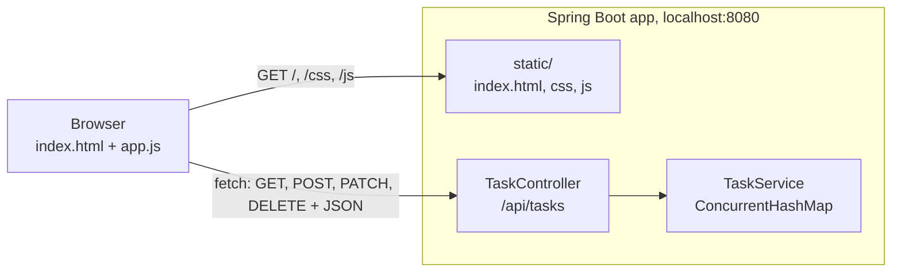
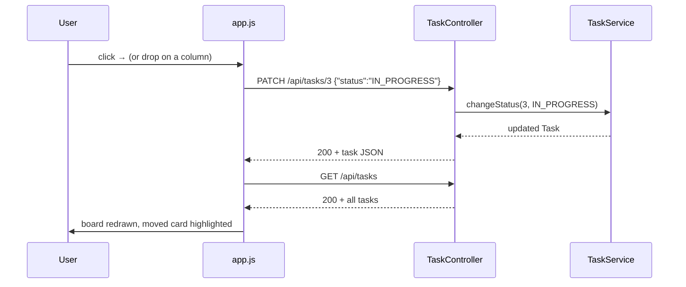

# TaskBoard

A small three-column task board (To Do, In Progress, Done), built to see clearly how a plain
JavaScript front end talks to a Spring Boot backend. It was planned and tracked in Jira, one story
per branch and pull request.

Built with Java 25, Spring Boot 4.2 and plain HTML, CSS and JavaScript. No frameworks on the front end,
no database, no Docker: one Maven command runs everything.

## Features

- Create a task from a form (the server checks the title)
- Move a task between columns with the arrow buttons or by drag and drop
- Delete a task (with a confirmation)
- Errors from the server are shown on the page, and a stale page refreshes itself
- A small "server says pong" check in the header

## How it fits together

Spring Boot serves both the page and the API, from the same jar and the same port, so there is no
CORS and no proxy.



One click, start to finish (moving a card):



### Where the files end up

| Where the file is | Who puts it there |
|---|---|
| `src/main/resources/static/index.html` | you |
| `target/classes/static/index.html` | Maven, on every build or run |
| inside the jar, `BOOT-INF/classes/static/index.html` | Maven, on `package` |
| http://localhost:8080/ | Spring Boot serves everything in `static/` at the root |

### The same names in three languages

| Java | JSON | HTML |
|---|---|---|
| `TaskStatus.TODO` | `"status": "TODO"` | `<section data-status="TODO">` |
| `TaskStatus.IN_PROGRESS` | `"status": "IN_PROGRESS"` | `<section data-status="IN_PROGRESS">` |
| `TaskStatus.DONE` | `"status": "DONE"` | `<section data-status="DONE">` |

## The API

| Method and path | Body | Success | Errors |
|---|---|---|---|
| `GET /api/ping` | | 200 `{"message":"pong","serverTime":"..."}` | |
| `GET /api/tasks` | | 200, all tasks sorted by id | |
| `GET /api/tasks/{id}` | | 200, one task | 404 |
| `POST /api/tasks` | `{"title":"Buy milk"}` | 201 + `Location` header | 400 empty or too long title, 415 without `Content-Type: application/json` |
| `PATCH /api/tasks/{id}` | `{"status":"DONE"}` | 200, the updated task | 400 unknown status, 404 |
| `DELETE /api/tasks/{id}` | | 204, no body | 404 |

A task looks like this:

```json
{
  "id": 3,
  "title": "Connect the page with fetch",
  "status": "TODO",
  "createdAt": "2026-11-22T11:03:23.713Z"
}
```

Try it with curl (Windows cmd):

```
curl -i -X POST http://localhost:8080/api/tasks -H "Content-Type: application/json" -d "{\"title\": \"Learn REST\"}"
curl -i -X PATCH http://localhost:8080/api/tasks/4 -H "Content-Type: application/json" -d "{\"status\": \"DONE\"}"
curl -i -X DELETE http://localhost:8080/api/tasks/4
```

## The front end

All calls go through one helper in `app.js`:

```javascript
await request('GET', '/api/tasks');
await request('POST', '/api/tasks', { title: 'Buy milk' });
await request('PATCH', '/api/tasks/3', { status: 'DONE' });
await request('DELETE', '/api/tasks/3');
```

`request(method, path, body)` adds the JSON header only when there is a body, turns the body into
JSON text, returns the parsed answer (or `null` for 204), and throws an `ApiError` with the status
and the server's message when something fails.

Other ideas used:

- **Wipe and redraw:** after every change the page asks for the full list again and rebuilds the board.
- **`textContent`, never `innerHTML`, for data:** a task title like `` shows as text.
- **Event delegation:** one click listener and five drag listeners on the board, so cards can be rebuilt freely.
- **`data-*` attributes** carry the task id and the target status from the card to the click handler.

## Run it

You need Java 25. The Maven wrapper downloads Maven by itself.

```
mvnw spring-boot:run
```

Open http://localhost:8080. Stop with Ctrl + C.

Or build one jar and run it without Maven:

```
mvnw package
java -jar target\taskboard-0.0.1-SNAPSHOT.jar
```

Notes:

- Tasks live in memory, so a restart brings back the three sample tasks.
- After changing a file in `static/`, restart the app: it serves the copy in `target/`.
- While developing, tick **Disable cache** in the browser's DevTools (Network tab).
- Only one app can use port 8080. `netstat -ano | findstr :8080` shows who holds it.

## Project layout

```
src/main/java/com/practice/taskboard/
  TaskboardApplication.java
  ping/PingController.java          GET /api/ping
  task/Task.java                    record: id, title, status, createdAt
  task/TaskStatus.java              TODO, IN_PROGRESS, DONE
  task/CreateTaskRequest.java       {"title": ...}
  task/UpdateStatusRequest.java     {"status": ...}
  task/TaskService.java             rules and the in-memory map
  task/TaskController.java          /api/tasks endpoints
src/main/resources/
  application.properties
  static/index.html
  static/css/styles.css
  static/js/app.js
```

## How it was planned

The work was tracked in Jira (Scrum, two one-week sprints) under the epic **TB-1 Mini task board v1**.
Every branch, commit and pull request starts with its key, and GitHub is linked to Jira, so each
card shows its own code.

| Key | Story |
|---|---|
| TB-3 | Serve a page from Spring Boot |
| TB-4 | REST API to list and create tasks |
| TB-5 | Show tasks on the board with fetch |
| TB-6 | Create a task from a form |
| TB-7 | Move a task between columns |
| TB-8 | Delete a task |
| TB-9 | Show API errors on the page |
| TB-10 | Drag and drop between columns |

## Limits

This is a learning project. On purpose it has no tests, no login and no database: tasks disappear on
restart, and anyone who can open the page can change them. A next step would be storing tasks with
Spring Data JPA, which would not change the front end at all.